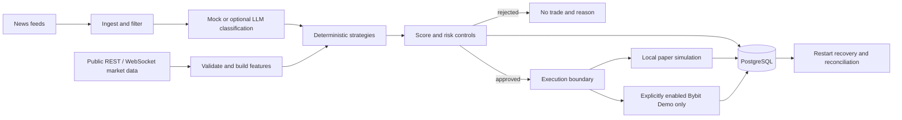

# ByBot

ByBot is a Python trading research and execution system for market data and news.
It supports local paper simulation and explicitly gated Bybit Demo execution;
**live exchange order submission is blocked**. Its optional LLM classifies news;
strategy selection, risk, position sizing and order execution remain code-driven.
This snapshot is for engineering review, not evidence of trading profitability.

## Engineering highlights

- FastAPI modular monolith with asynchronous news and market-processing loops.
- PostgreSQL and SQLAlchemy persistence for candidates, risk decisions, execution
  transitions and portfolio state; Alembic manages schema migrations.
- Durable reservations, idempotency constraints and per-symbol coordination
  protect against duplicate submissions and conflicting positions.
- Startup recovery and reconciliation compare persisted state with authoritative
  exchange state; uncertain protection or critical failures block new entries.
- Deterministic risk, freshness and exposure checks; public REST/WebSocket data.
- Unit and integration tests, a Docker image and a synthetic local paper demo.

## Architecture



The news-to-paper workflow and V2 strategy runtime share components but are
separate paths. V2 implements six strategies; Range Mean Reversion is disabled
by default. Research modules under `app/v4/` and `app/v5/` are experimental,
not evidence of validated alpha. See [architecture](docs/ARCHITECTURE.md) and
[strategies](app/v2/strategies.py).

## Five-minute local paper demo

Requires Docker Desktop, Docker Compose and Windows PowerShell. From this folder:

```powershell
powershell -ExecutionPolicy Bypass -File .\scripts\portfolio_demo.ps1
```

The isolated Compose project starts PostgreSQL and the API with mock data and
classification. It checks safety, injects synthetic news, rejects stale data,
creates a paper trade, checks a duplicate, closes it and recreates the API to
verify recovery from PostgreSQL. It does not use exchange credentials, send
orders or call an LLM. The first image build may take longer than five minutes.

On a successful run, checkpoints include `STALE MARKET DATA -> NO_TRADE: PASS`,
`IDEMPOTENT DUPLICATE: PASS`, `POSTGRESQL RECOVERY -> SAME TRADE AND EQUITY: PASS`
and `OVERALL: PASS`.

- [Health](http://127.0.0.1:8010/health), [API explorer](http://127.0.0.1:8010/docs),
  [paper trades](http://127.0.0.1:8010/paper/trades) and
  [paper PnL](http://127.0.0.1:8010/paper/pnl).
- Run again with `-SkipBuild` only after building the image.
- Stop containers and retain demo data:
  `docker compose -p bybot-portfolio -f compose.portfolio.yml down`.
  Add `-v` only when intentionally deleting the demo database.

## Stack and validation

Python 3.11, FastAPI/Pydantic, PostgreSQL, SQLAlchemy/Alembic, Docker Compose,
pytest and Bybit REST/WebSocket APIs. Development setup uses
`python -m pip install -r requirements-dev.txt`, then `python -m pytest -q`.
The PostgreSQL-specific tests require `BYBOT_TEST_POSTGRES_URL` pointing to a
disposable database named `bybot_test*` or `*_test`; otherwise they are skipped.
Use the `postgresql+psycopg://` URL scheme for the psycopg v3 driver.
Never point tests at a real database. The CI workflow runs the safe suite with
an isolated PostgreSQL service. Its result must be checked on GitHub.

## AI and safety boundaries

The optional LLM receives filtered, compact news and returns structured
classification. Its output is validated and may be rejected; it cannot size or
submit an order, override risk or orchestrate strategies. The default mock
classifier needs no API key. LLM availability, output quality and cost are
limitations; tests and the local demo use mocks.

The demo is PAPER only. A separate execution path can submit orders **only** to
Bybit Demo after explicit configuration, credentials and authorization. Live,
mainnet and testnet order execution are blocked. The API has no authentication;
some test-named endpoints are not restricted to TEST_MODE. Run it on a trusted
local machine only, never expose it directly to the internet. Local Compose
credentials are examples, not production credentials.

## Known limitations

- Single-process runtime and in-memory market feature history limit restart and
  horizontal scaling; not a production deployment design.
- Legacy financial tables use floating-point storage; large execution and runtime
  modules need careful future decomposition with regression coverage.
- External market/news availability, exchange behavior and simulated costs can
  differ from observed fills. Backtests do not prove future performance.
- Dependency ranges are not locked; security scanning and deployment hardening
  are still needed. GCP deployment is a plan, not a verified deployment.
- This sanitized public snapshot excludes private account data and private replay
  fixtures, so its tests do not prove full real-exchange behavior.

## Documentation

[Architecture](docs/ARCHITECTURE.md) · [Project state](docs/PROJECT_STATE.md) ·
[Runbook](docs/RUNBOOK.md) · [Security](docs/SECURITY.md) ·
[Planned GCP deployment](docs/GCP_DEPLOYMENT.md) ·
[Backtesting code](app/backtest/) · [Configuration](app/config.py)
