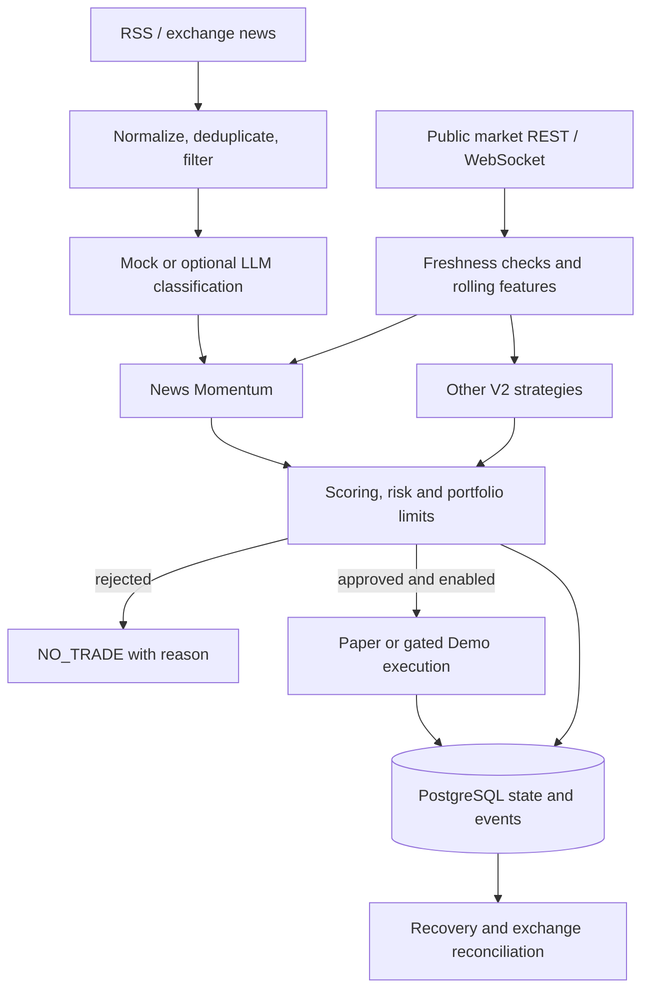

# Architecture

ByBot is a Python modular monolith. FastAPI hosts background processing and an
unauthenticated operational API; SQLAlchemy persists workflow state. The public
snapshot has two related paths: a news-to-paper workflow and an optional V2
strategy engine that can use explicitly authorized Bybit Demo execution.

The classifier produces structured sentiment and metadata from compact filtered
news. Code validates its output, selects and scores candidates and applies
risk/execution gates. It does not hand account state to the LLM or allow the LLM
to place an order. Mock classification is the default. Failures can reject an
input or block entries; no claim of perfect fault tolerance is implied.

The six V2 strategies are News Momentum, Volume Breakout, Open Interest / Funding
Squeeze, Liquidation Momentum, Meme Trend and Range Mean Reversion. The last is
disabled by default. News processing runs asynchronously alongside market
cycles; strategy evaluation within a cycle is not six parallel agents.

The paper path keeps simulated positions and account state in the database. The
Demo path requires multiple explicit configuration gates and exact Demo domains.
A durable reservation precedes submission, an acknowledgement is not a fill,
and remote state is reconciled; uncertain protection is handled fail-closed.
Per-symbol execution coordination and database constraints support idempotency.
Neither path is a live-execution adapter.

`app/news/` handles ingestion and classification; `app/v2/` implements market
features, strategies, scoring and the V2 runtime; `app/risk/` contains risk
checks for the news/paper pipeline; `app/bybit/` handles market and Demo exchange
integration; `app/db/` and `alembic/` handle persistence and migrations;
`app/backtest/` implements historical simulation with costs and metrics. V2 also
has its own portfolio and risk controls; `RiskManager` is not the sole gate for
all V2 execution.

V4/V5 research and shadow analysis are experimental. GCP deployment is planned,
not demonstrated here. Feature history is largely in memory, and multiple
workers require additional coordination. For implementation and operational
limits see [project state](PROJECT_STATE.md), [security](SECURITY.md) and
[runbook](RUNBOOK.md).
